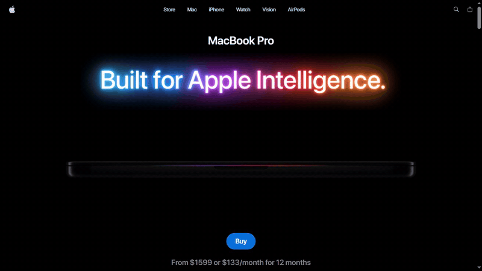
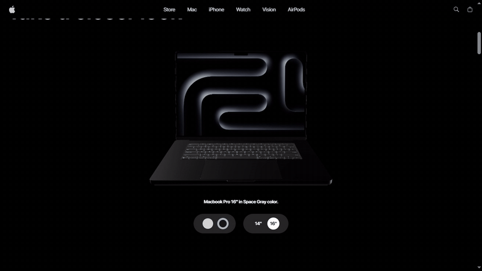
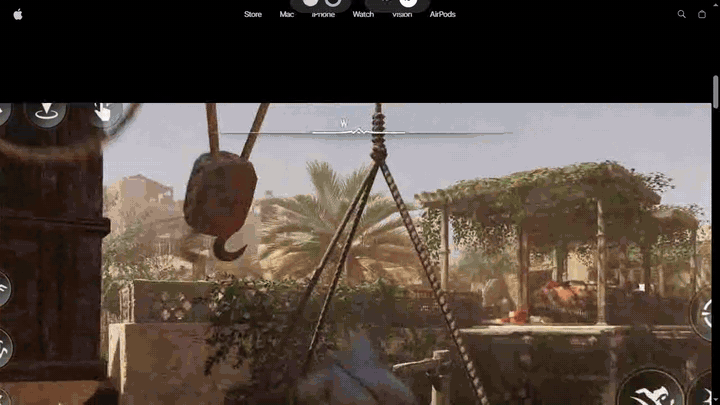

# MacBook GSAP Experience

**An Apple-style MacBook Pro product page, built to explore GSAP and Three.js in React.**

Scroll-driven storytelling with a live 3D MacBook you can recolor and resize, video masked into type, and a pinned features section where the laptop turns to show each screen.



## Highlights

- **Interactive 3D viewer**: switch between the 14" and 16" models and two finishes, with smooth GSAP transitions between them
- **Scroll-driven 3D**: a pinned section rotates the MacBook and swaps its screen video as each feature scrolls into view
- **Video in type**: gameplay footage plays through the Apple logo and "M4" lettering
- **Studio lighting**: a custom light rig for a clean, product-shot look
- **Responsive**: layouts and animations adapt to smaller screens

| 3D product viewer | Scroll-driven story |
| --- | --- |
|  |  |

## Tech stack

React 19 · Vite · Tailwind CSS v4 · GSAP (ScrollTrigger, `@gsap/react`) · Three.js · React Three Fiber · Drei · Zustand

The selected model's color, scale and screen texture live in a small Zustand store (`src/store`), shared by the 3D viewer and the scroll animations.

## Getting started

```bash
npm install
npm run dev
```

| Command | Description |
| --- | --- |
| `npm run dev` | Start the dev server |
| `npm run build` | Production build |
| `npm run preview` | Preview the production build |
| `npm run lint` | Lint the project |

---

Built for learning and portfolio purposes.
